# 空间计算器 Spatial Calculator

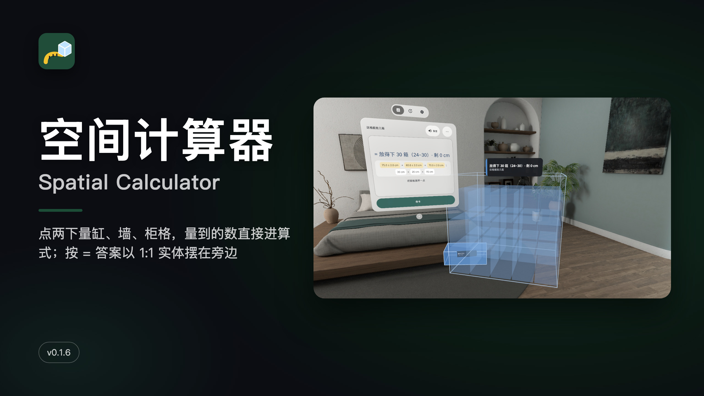

[中文](#中文) · [English](#english) · 当前版本 / Current version: **v0.1.6** · [CHANGELOG](CHANGELOG.md)

## 中文

手机计算器只给你一个数；这个计算器把答案按真实大小摆在房间里。点两下量一个鱼缸、一面墙、一格柜子，量到的尺寸（带 ± 误差）直接进算式；按「=」，答案长成 1:1 的水块、砖面、一摞箱子，就摆在那个东西旁边，够不够、装不装得下，一眼看见。

PICO OS 6 混合现实应用（PICO Spatial SDK 6.1.9）：Stage 透视场景放尺带和结果体，一个系统窗口放算式。

### 截图

| | |
|---|---|
| 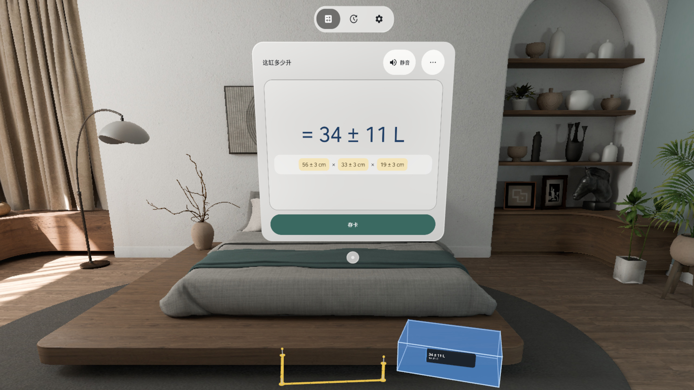 这缸多少升：点两下量了三边，按 = 一块 1:1 水块长在量的地方旁边 | 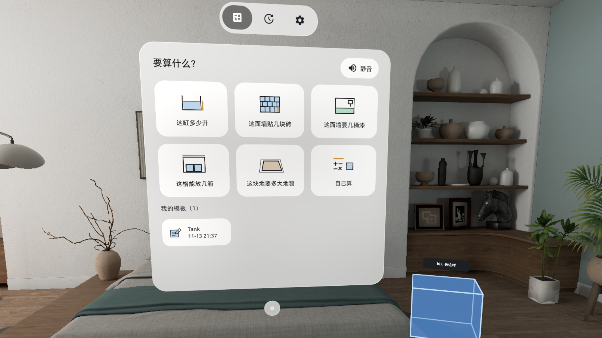 要算什么：六件常用的事，或者自己写算式 |
|  这面墙贴几块砖：砖面直接贴在墙上，18 块 · 多买 2 块 | 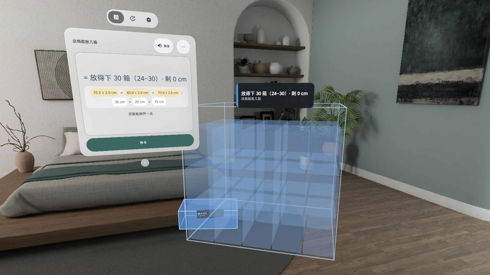 这格能放几箱：拟合盒对齐柜格，幽灵箱码进格子，放得下 30 箱 |
| 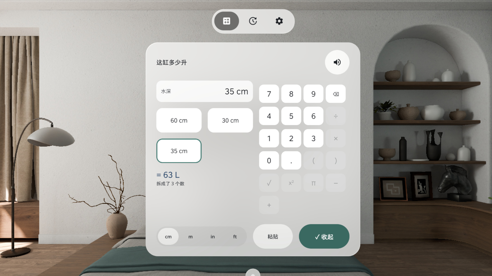 粘贴商品页的「60×30×35 cm」自动拆成三个数，底栏 [粘贴][✓ 收起] 固定 | 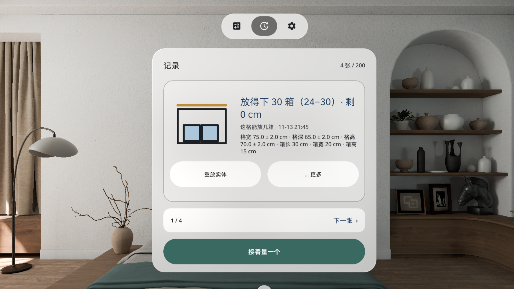 记录：每次量算一张卡，重放实体；钉住、存成模板在「⋯ 更多」里 |

截图是 v0.1.6 在模拟器上拍的，3D 操作由调试广播驱动，**非真实手势录像**。

### 能算什么

- 这缸多少升（方缸 / 圆缸）→ 1:1 水块
- 这面墙贴几块砖、这面墙要几桶漆 → 砖面 / 漆带贴在墙上
- 这格能放几箱：拟合盒对齐柜格 + 粘贴箱子尺寸 → 幽灵箱码进格子
- 这块地要多大地毯 → 量的范围 + 最接近的常见尺寸
- 自己算：量到的数和手输的数混在一个算式里，单位自动换算，误差一起传下去

### 怎么用

- 对着东西点两下落钉（手柄射线或眼动 + 捏合）；也可以键盘打数或粘贴尺寸
- 结果体可以拖过去比一比，摇杆左右转；钉住后下次打开还在原处
- 每页只留要用的几个键，不常用的收进「⋯ 更多」；静音键一直在
- 记录页存下每次量算；公制 / 英制、L / gal 随时切；设置里可以重开面板、退出应用
- 中英双语，全部本机运行，不联网、不需要账号

### 安装

Release 里的 APK 是 `assembleRelease` 出的未签名包（上架用），自己装请先签名，或从源码构建 debug 包：

```bash
export JAVA_HOME=~/.pico/primer-cli/jdk/jdk-21.0.13+9/Contents/Home   # 任意 JDK 17+
./gradlew assembleDebug
adb install -r app/build/outputs/apk/debug/app-debug.apk
pico-cli app launch io.embodit.spatialcalc
```

已知问题：选活页存了模板后可点控件 17–18 个（题目 + 模板本身是内容）。v0.1.6 已装到头显，还没戴上验：每个手柄只一条射线、眼手捏合落钉、拖结果体、外放响度。

## English

A phone calculator gives you a number; this one puts the answer in your room at real size. Tap twice to measure a fish tank, a wall or a shelf cell, and the reading (with its ± error) goes straight into the formula. Press = and the answer grows into a 1:1 block of water, a tiled wall or a stack of boxes right next to the real thing, so you can see at a glance whether it fits.

A PICO OS 6 mixed-reality app (PICO Spatial SDK 6.1.9): a passthrough Stage for tapes and result bodies, one system window for the formula.

### Screenshots

| | |
|---|---|
| 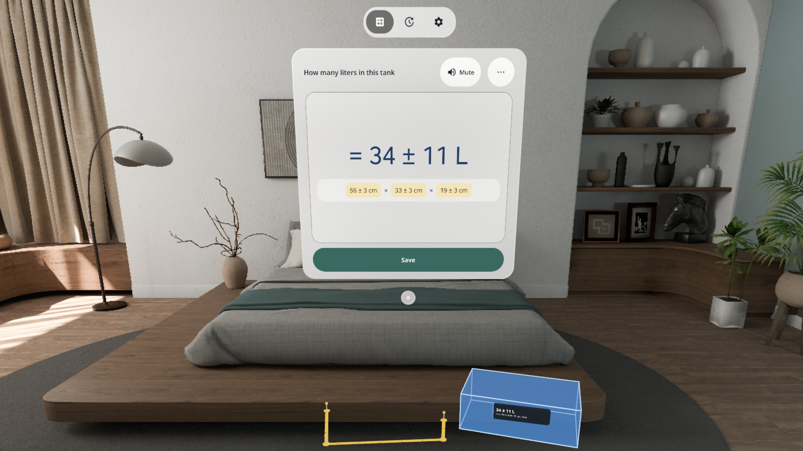 How many liters in this tank: three sides measured, = grows a 1:1 water block beside it | 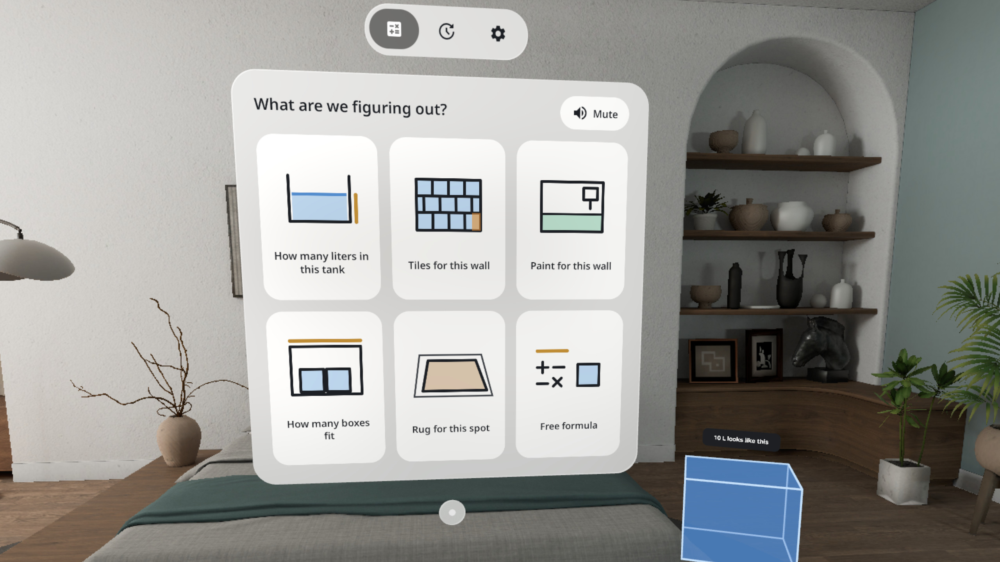 Six everyday jobs, or write your own formula |
| 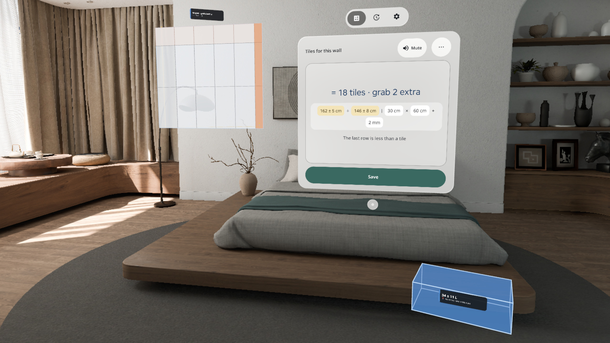 Tiles for this wall: the tiles sit on the wall, 18 tiles, grab 2 extra | 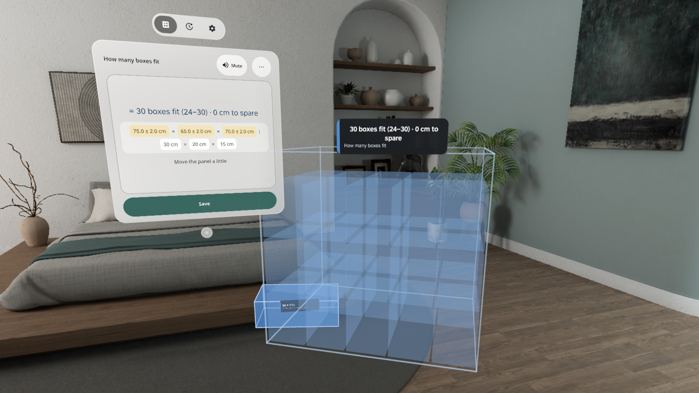 How many boxes fit: a fit box lines up with the cell, 30 ghost boxes stack inside |
| 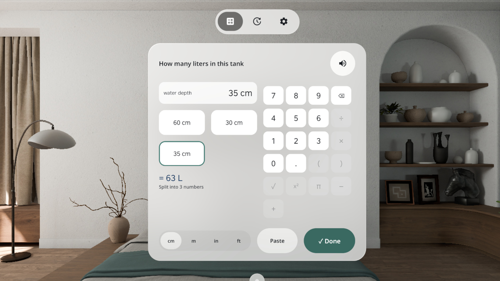 Paste "60x30x35 cm" from a product page and it splits into three numbers; [Paste] / [✓ Done] stay on the bottom bar | 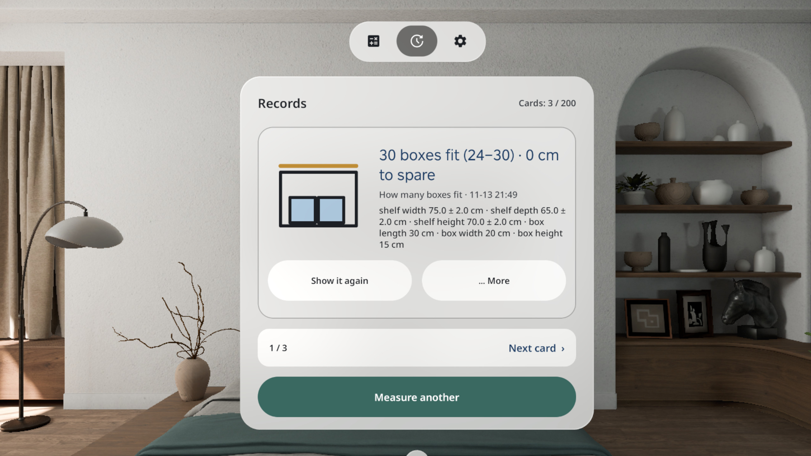 Records: one card per calculation, show it again; pin and save as template under "⋯ More" |

Screenshots are v0.1.6 on the emulator; 3D input was driven by debug broadcasts, **not a recording of real hand input**.

### What it does

- Liters in a box or round tank → a 1:1 water block
- Tiles or paint for a wall → tiles / a paint band on the wall
- How many boxes fit: a fit box on the shelf cell + pasted box size → ghost boxes stacked inside
- Rug for this spot → the measured area plus the closest common rug size
- Free formula: measured and typed numbers together, units converted, the error carried through

### How it works

- Tap two points to drop pins (controller ray or gaze + pinch); or type / paste sizes
- Drag a result body to compare, turn it with the thumbstick; pin it and it is still there next time
- Each page keeps only the buttons you need; the rest live under "⋯ More"; Mute is always there
- Records keep every calculation; metric / imperial, L / gal; Reopen panel and Quit app in Settings
- Chinese and English, fully offline, no account

### Install

The APK on the Release is the unsigned `assembleRelease` build (for store upload). To sideload, sign it first or build a debug APK from source:

```bash
export JAVA_HOME=~/.pico/primer-cli/jdk/jdk-21.0.13+9/Contents/Home   # any JDK 17+
./gradlew assembleDebug
adb install -r app/build/outputs/apk/debug/app-debug.apk
pico-cli app launch io.embodit.spatialcalc
```

Known issues: with saved templates the pick page has 17–18 tappable items (the jobs and templates are the content). v0.1.6 is installed on a headset but not yet checked there: one ray per controller, gaze + pinch pins, dragging result bodies, speaker loudness.

## Credits

Started from [Spatial Ruler](https://github.com/kejing-dev/SpatialRuler) (plane hits, world anchors, system pointer, the tap-to-plane rule). Font: Noto Sans (SIL OFL 1.1). Sounds: Kenney (CC0) and freesound #390391 by N-RAZM (CC0).
