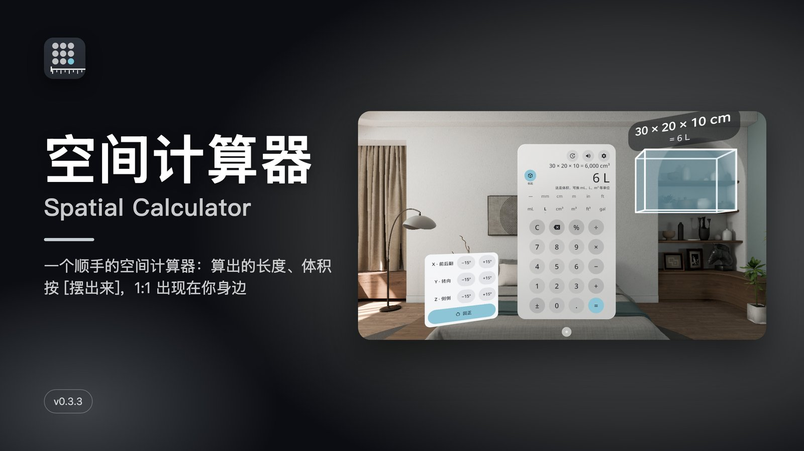
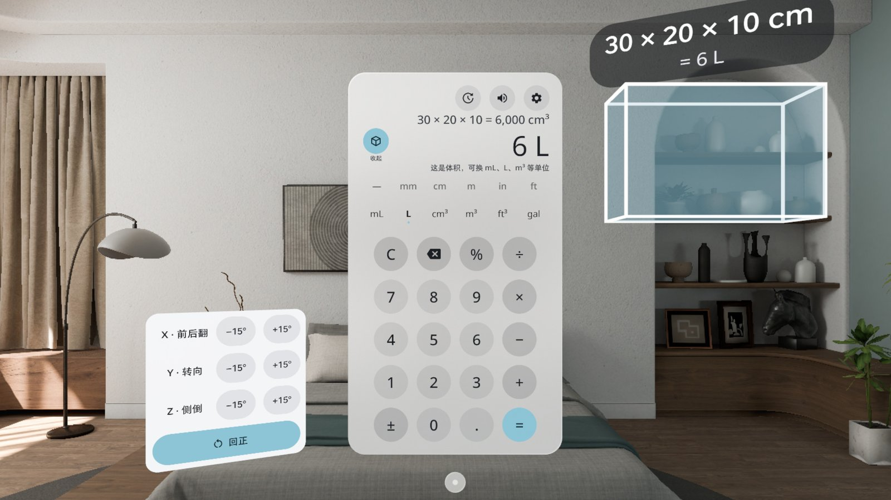
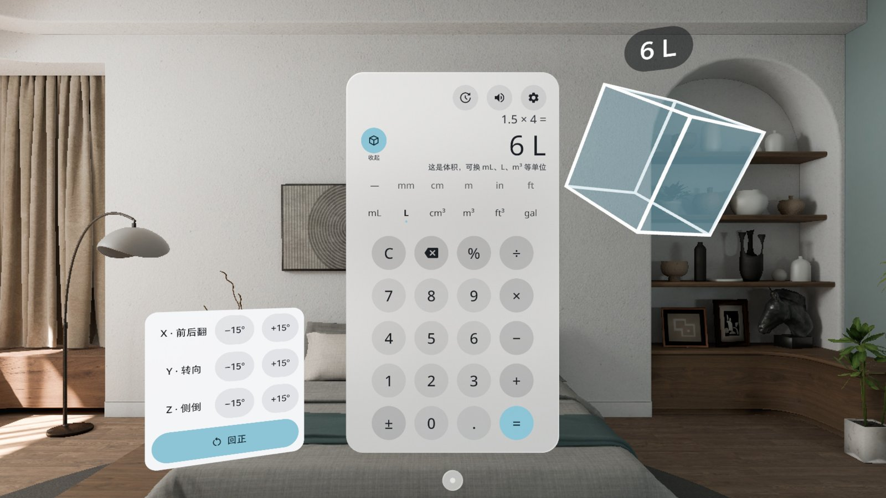
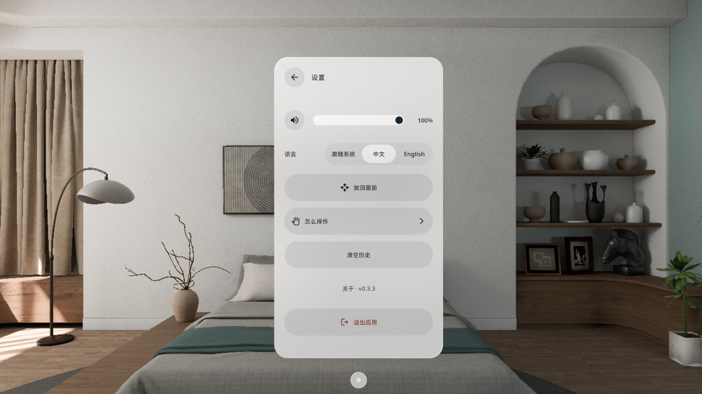
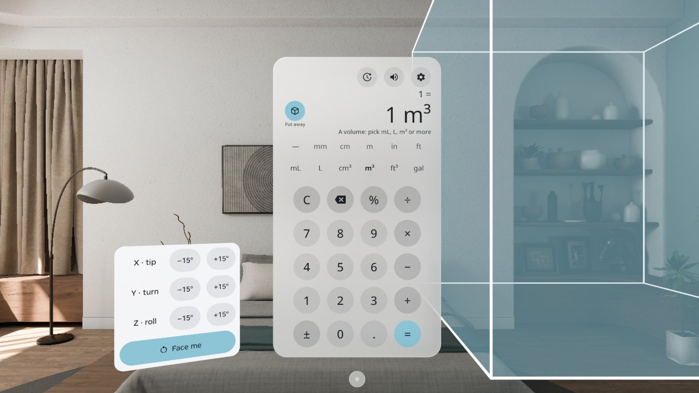
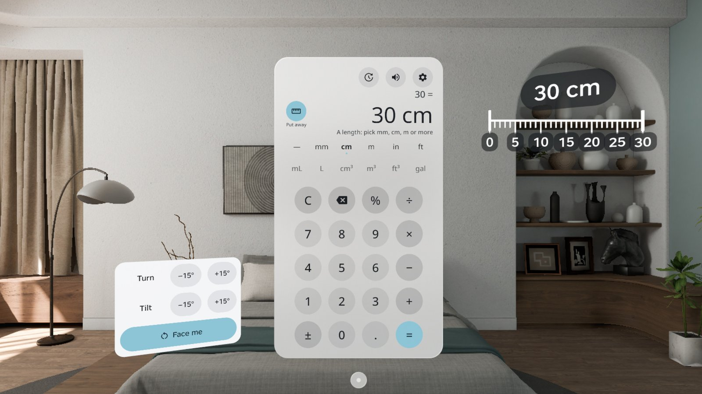
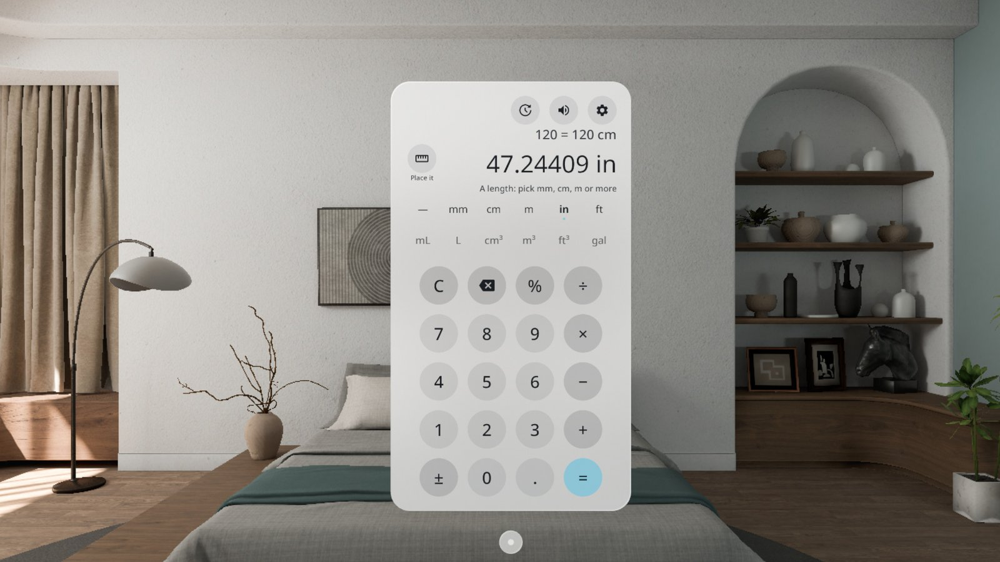

# 空间计算器 · Spatial Calculator



PICO OS 6（Spatial SDK 6.1.9）· v0.3.3 · 中文 / English

[中文](#中文) · [English](#english)

## 中文

打开就是一个顺手的计算器，挂在你面前的玻璃窗里。算出来是个长度或体积，按 [摆出来]，答案就按真实大小出现在窗口旁边：30 cm 是一条带刻度的 1:1 线，6 L 是一个玻璃方块，30 × 20 × 10 cm 就是那个盒子。

- 四则运算：先乘除后加减、%、±、⌫、连按 =，小数精确（0.1 + 0.2 = 0.3）
- 两排单位：长度 mm cm m in ft，体积 mL L cm³ m³ ft³ gal；有结果后只亮同量纲单位，点一下就换算（最多 7 位有效数字）
- [摆出来]：长度 → 1:1 刻度线；体积 → 1:1 玻璃方块；a × b × c → 那个盒子
- 摆出来的东西能拖、能转：线两轴、方块三轴；旋转面板 ±15°、手柄握把 + 摇杆、双手扭，[回正] 一键对着你
- 最近 20 条历史，静音键常显，中英双语，全部本机运行、不联网、不要账号

| | |
|---|---|
|  30 × 20 × 10 cm = 6 L 的盒子按 1:1 摆在窗口旁 |  1 m³ 的玻璃方块 |
|  30 cm 的 1:1 刻度线 |  方块转了两轴，[回正] 对着你 |
|  120 cm → 47.24409 in，另一排单位置灰 |  设置 · 关于 v0.3.3 |

截图和演示视频都在模拟器里拍，3D 操作由调试广播驱动，**非真实手势录像**。

### 安装

从 [Release v0.3.3](https://github.com/kejing-dev/SpatialCalculator/releases/tag/v0.3.3) 下载 `SpatialCalculator-v0.3.3.apk`（assembleRelease 出的**未签名**包，供上架平台托管签名；本机安装请自己签名，或用 `./gradlew assembleDebug` 出的 debug 包）：

```
adb install -r <apk>
pico-cli app launch io.embodit.spatialcalc
```

### 已知问题

- 极小数如 1 mL → ft³ 显示 3.531e-5（值正确）
- 方块标签比窗口少一位小数
- 有结果时换量纲（长度 ↔ 体积）要先按 C、输入新数字或 [—]
- 控制器 / 双手扭 / 拖动手感、冷启动只在模拟器里逐项验过

## English

Opens straight into a calculator in a glass window in front of you. When the answer is a length or a volume, press [Place it] and it appears beside the window at real size: 30 cm as a 1:1 line with ticks, 6 L as a glass cube, 30 × 20 × 10 cm as that box.

- + − × ÷ with precedence, %, ±, ⌫, repeated =, exact decimals (0.1 + 0.2 = 0.3)
- Two unit rows: mm cm m in ft and mL L cm³ m³ ft³ gal; with a result only the same kind is lit, a tap converts (≤ 7 significant digits)
- [Place it]: a length → a 1:1 line with ticks; a volume → a 1:1 glass cube; a × b × c → that box
- Drag and turn it: line on 2 axes, box on 3; turn panel ±15°, grip + stick, two-hand twist, [Face me]
- Last 20 results, mute always on screen, Chinese / English, fully offline, no account

| | |
|---|---|
|  A 30 × 20 × 10 cm = 6 L box at 1:1 |  A 1 m³ glass cube |
|  30 cm as a 1:1 line |  A turned cube; [Face me] squares it |
|  120 cm → 47.24409 in, other row greyed |  Settings · About v0.3.3 |

Screenshots and the demo video were captured on the emulator with 3D actions driven by debug broadcasts — **not a recording of real hand gestures**.

### Install

Download `SpatialCalculator-v0.3.3.apk` from [Release v0.3.3](https://github.com/kejing-dev/SpatialCalculator/releases/tag/v0.3.3) (an **unsigned** assembleRelease build for store-side signing; sign it yourself or build `./gradlew assembleDebug` to sideload):

```
adb install -r <apk>
pico-cli app launch io.embodit.spatialcalc
```

### Known issues

- Tiny values such as 1 mL → ft³ show 3.531e-5 (the value is correct)
- The box label shows one decimal fewer than the window
- To switch between length and volume after a result, press C, type a new number or [—] first
- Controller / two-hand twist / drag feel and cold start were checked item by item only on the emulator

## Build

`./gradlew assembleDebug` / `./gradlew assembleRelease` (JDK 21). Debug commands and the screenshot list: `AGENTS.md`. Changes: `CHANGELOG.md`.
